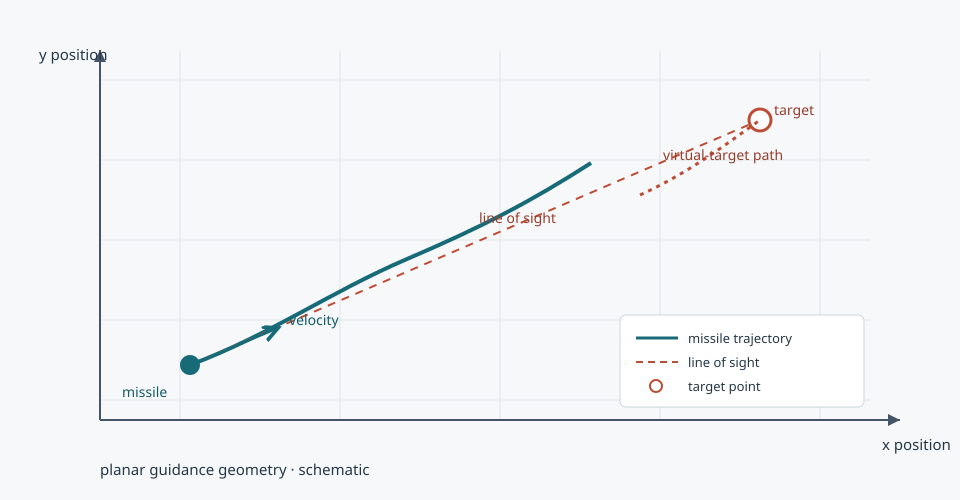

# VTIACG

**VTIACG** is a set of Python scripts for two-dimensional missile and virtual-target guidance simulations, parameter studies, comparisons, and plots. The numbered folders preserve the existing experiment organization.

[Project homepage](https://paoshou-china.github.io/VTIACG/) · [Browse source](https://github.com/PaoShou-China/VTIACG)

## Project overview / 项目概览

The repository contains separate script collections rather than one installable package or unified runner. The simulation code defines missile and virtual-target models; additional scripts run batches or parameter searches and produce comparisons and plots.

本仓库按编号目录保存若干独立的仿真脚本，并非统一安装包或单一运行器。仿真代码包含导弹和虚拟目标模型；其他脚本用于批量运行、参数搜索、结果比较和绘图。

## Repository map / 目录结构

| Path | Contents |
| --- | --- |
| 0/ | main.py: standalone missile/virtual-target simulation and plotting |
| 1/ | Simulation, batch, parameter search, comparison, plotting |
| 2/ | Simulation, batch, parameter/seed/state search, comparison, plotting |
| 3/ | Simulation, comparison, plotting |

Run scripts from their own directory. Files with the same name in different numbered folders are separate experiment variants.

## Requirements / 环境依赖

The inspected scripts use Python, NumPy, and Matplotlib. Some experiment scripts may require additional libraries; check their imports before running.

~~~bash
python -m venv .venv
source .venv/bin/activate       # Windows PowerShell: .venv\\Scripts\\Activate.ps1
python -m pip install --upgrade pip
python -m pip install numpy matplotlib
~~~

## Quick start / 快速开始

Run the standalone example from folder 0:

~~~bash
cd 0
python main.py
~~~

For another experiment, enter its numbered folder and run the desired script, for example python simulation.py or python batch.py. Inspect its main block first: batch or parameter-search scripts may run longer than a single simulation. Plot windows require a graphical environment.

## Parameter search CLI / 参数搜索命令

Folders `1/` and `2/` provide a Bayesian search entry point. Run it from the chosen folder:

~~~bash
python parameter_search.py --calls 100 --seed 42 --workers 4 --output results/best.json
~~~

`--workers` must be a positive integer; `--calls` must be at least 10 (the optimizer's default initial design requires ten points). The worker count is bounded by the number of simulation cases; results are written only when `--output` is supplied. Folder-local `simulation.py` and its parameter list remain the source of the experiment cases.

目录 `1/` 和 `2/` 提供贝叶斯参数搜索入口，应在对应目录内执行。搜索次数至少为 10（贝叶斯优化默认初始设计需要十个点），工作进程数必须为正整数；工作进程数不会超过仿真案例数。只有指定 `--output` 时才会写出 JSON 结果，仿真案例仍由当前目录的 `simulation.py` 和参数列表提供。

## Reproduction notes / 复现说明

- Record the folder, script, parameters, random seed, and package versions with each result.
- Some scripts seed NumPy at module scope; others may use separate or no seed handling.
- There is no shared experiment configuration or single runner at present; use each script's current parameters.

复现实验时请记录目录、脚本、参数、随机种子及依赖版本。部分脚本在模块级设置 NumPy 随机种子，其他脚本可能使用不同策略。本仓库当前没有统一配置文件或总运行入口，应以所选脚本中的参数为准。
